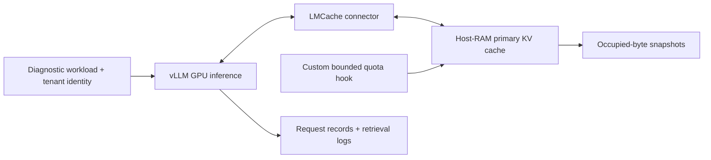

# Multi-tenant CPU KV-cache feasibility

**Team branch:** start with [the team handoff](docs/team/START_HERE.md) for the research question, measured outputs, test catalog, collaboration plan and reproducibility instructions. This branch adds documentation and curated historical evidence to the basic starter on `main`.

**Research question:** under a fixed CPU-memory KV-cache budget, can adapting per-tenant allocations improve latency and fairness when workloads change?

A basic research prototype for **GPU inference with CPU-RAM KV caching** using Qwen2.5-7B, vLLM and LMCache. It contains three independent diagnostics:

| Command | Purpose | Cache capacity |
|---|---|---:|
| `tenants` | Compare cache_salt alone with explicit LMCache tenant tags across 16 identities | 2 GiB |
| `quota` | Change one of four tenants' retained bytes during inference using a bounded custom L1 hook | 2 GiB |
| `scale` | Populate 600 unique 4K prefixes and inspect retained KV plus oldest/newest retrieval | 128 GiB |

**Status:** the original diagnostics passed on ASU Sol. This repository cleans their launch paths, pins the model revision and organizes outputs. The cleaned launcher has not received a fresh GPU run. This is not an adaptive allocation controller, an HTTP serving benchmark, or a combined 128 GiB / 16-tenant / live-quota implementation.

## Architecture



The team code supplies workloads, worker diagnostics, quota enforcement and analysis. vLLM performs inference; LMCache supplies storage and transfer. The hook uses pinned-version internal fields and is not a stable public management API. See [limitations](docs/LIMITATIONS.md).

## Prerequisites

- A Slurm GPU allocation and Apptainer on the compute node.
- The tested GPU container and cached model revision in [environment provenance](docs/ENVIRONMENT.md). This repository does not install or bundle models/images.
- Python 3.10+ for the diagnostic and analysis code (provided by the tested image); the small host resource monitor uses Python 3.6+.
- Explicit host RAM for the cache plus runtime overhead. The scale test used 192 GiB allocated RAM for a 128 GiB cache.

Do installation, inference and memory tests on allocated compute nodes. Documentation and static checks do not require a GPU.

## Configure and run

```bash
cp configs/example.env configs/local.env
# Edit configs/local.env to match your existing image and scratch/model paths.
```

From the repository root, submit a job using your authorized account, partition and QoS:

```bash
sbatch --account=YOUR_ACCOUNT --partition=YOUR_PARTITION --qos=YOUR_QOS \
  scripts/gpu_job.sbatch tenants
```

Replace `tenants` with `quota` or `scale` for the other diagnostics. The example allocation requests one A100, 16 CPUs and 192 GiB for 30 minutes. For the two small diagnostics you can override the job's GPU/memory requests to match a suitable authorized allocation; historical small runs used an A30 with 40 GiB host RAM. Do not reduce the scale job to 128 GiB total RAM.

Inside an **existing suitable GPU compute allocation**, the equivalent command is:

```bash
bash scripts/run.sh tenants
```

Each run creates `runs/gpu-MODE-JOBID/` (scale uses `gpu-scale-JOBID`). It contains `run.log`, `launch.json`, memory samples and diagnostic-specific JSON files. An existing run directory is refused. To repeat inside the same allocation, set `DIS_ML_RESULT_DIR` to a new absolute directory whose parent exists. A successful process exit alone is not proof of cache reuse: inspect the generated analysis and original logs.

The workload constants intentionally match the historical tests. Changing model, prompt length, cache chunks or connector may invalidate analysis assumptions such as the expected 768-token retrieval.

## Analyze a saved run

With Python 3.10+ and no GPU imports:

```bash
python3 scripts/analyze_gpu_tenant_probe.py runs/gpu-tenants-JOBID
python3 scripts/analyze_primary_quota_probe.py runs/gpu-quota-JOBID
python3 scripts/analyze_gpu_scale_occupancy.py runs/gpu-scale-JOBID
```

Analyzers write derived JSON in the selected run directory. Preserve the original evidence or analyze a copy. Legacy adjacent `.log` files remain supported. The scale analyzer expects Linux cgroup-v1 job memory samples matching the tested Sol environment; other configurations need an explicitly validated memory adapter.

## Local checks

```bash
python3 -m unittest discover -s tests -v
bash -n scripts/run.sh scripts/gpu_job.sbatch
```

No command above starts a model except the explicit Slurm/run commands. [Historical results](docs/RESULTS.md) and [validation notes](docs/VALIDATION.md) separate measured evidence from checks on this cleaned version.

## Scope for the next version

Integrate the independent mechanisms; instrument GPU streaming latency; implement a simple adaptive policy; compare fixed/manual/adaptive quotas under equal budgets and changing demand. Keep new raw run outputs, model caches, credentials and local configuration out of Git. This team branch intentionally includes the curated, checksummed historical evidence under `docs/team/evidence/`. The original private research archive, chats and instructor correspondence are not part of this repository.
