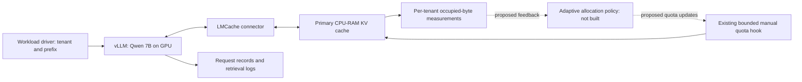

# Project, architecture and concepts

## Research questions to finalize together

1. Under a fixed CPU-memory cache budget, how does allocation affect per-tenant reuse, TTFT and throughput under contention?
2. After demand changes, can a feedback policy improve a defined latency/fairness objective over fixed equal allocation?
3. What overhead and regressions does adaptation cause: eviction/refill, slow enforcement, oscillation or harm to quieter tenants?

These are proposed questions; the current evidence answers mechanism and resource feasibility, not adaptive-policy effectiveness. Choose the objective before implementing/tuning the policy. Do not claim novelty until positioning it against relevant prior work.

## Option 1 system

Solid components were exercised in separate diagnostics. Dashed feedback connections are future work. The diagram does not mean all components have passed a combined 128 GiB test.

## What comes from libraries versus our code

| Component | Responsibility | Status |
|---|---|---|
| Qwen2.5-7B | Model weights and tokenization | Existing model, pinned revision |
| vLLM | GPU scheduling, prefill, decoding and connector calls | Existing serving engine |
| LMCache | KV storage/transfer, cache entries, eviction eligibility | Existing cache library |
| Workload probes | Controlled repeated/unique prefixes and tenant tags | Team scripts in this repository |
| Occupancy worker extension | Sum actual cache-object bytes under the backend lock | Team diagnostic, uses internal APIs |
| Primary quota hook | Scheduled manual limits; safe eligible-entry removal | Team prototype, bounded duration |
| Analyzers | Join request IDs to retrieval evidence; summarize bytes/events | Team scripts; saved-log regression checked |
| Adaptive policy | Select quotas automatically from observed demand/utility | Not implemented |

## Why the manual-quota mechanism matters

The small test first measured each tenant's occupied bytes, lowered A to zero, then raised A to three times its initial occupancy while batches ran. The hook held the cache lock, checked eviction eligibility and used reference-counted removal. It stopped after the diagnostic and changed no installed library package.

This proves that a controllable mechanism can alter retention on the pinned stack. It does not prove stable behavior at sustained concurrency, a production management API, an optimal quota, or a performance benefit. The hook is limited to a 30-second lifetime and a 100 ms loop.

The GPU identity test showed cache_salt alone did not distinguish external entries on this legacy connector. `lmcache.tag.tenant`, passed through sampling extra arguments, did. This is a version-specific mechanism finding, not a general security guarantee.

## Vocabulary

| Term | Meaning |
|---|---|
| Prefill | Process input tokens and compute their KV tensors |
| Decode | Generate subsequent output tokens using model state |
| Prefix reuse | Retrieve KV for a matching token prefix instead of recomputing it |
| Active engine KV | Memory the inference engine needs for current sequences |
| External retained KV | Data LMCache keeps for possible later reuse |
| Native prefix cache | vLLM's own reuse mechanism; disabled in our attribution tests |
| Tenant quota | Target/limit for a tenant's retained bytes; not a request-rate limit |
| Soft quota | Enforcement can lag the update and may wait for entries to become evictable |
| Primary L1 / secondary L2 | LMCache storage tiers in the tested configurations; not CPU hardware cache levels |
| RAM-backed L2 | Files in `/dev/shm` consuming RAM, potentially duplicating L1 tensors |
| Cache pressure | Useful retained working set exceeds available capacity |
| GiB / MiB | 2^30 / 2^20 bytes, distinct from decimal GB/MB |
| NUMA | Memory locality domains; CPU worker binding can limit usable local RAM |

## Candidate adaptive design, not implemented

A simple first policy could collect per-tenant demand/reuse statistics periodically, retain a minimum allocation for each tenant, redistribute the remaining fixed budget, cap changes per interval and use hysteresis. The team still needs to specify the signal and objective, how usefulness is estimated, how cold tenants are handled and how the policy avoids oscillation. Do not describe this candidate as a tested algorithm.

See [the test evidence](TESTS_AND_RESULTS.md) and [the experiment plan](METRICS_AND_EXPERIMENTS.md) before deciding which claims to make.
